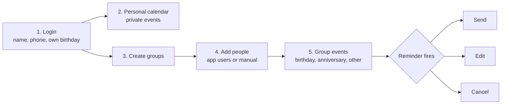

<div align="center">

# 🎂 Group Birthday & Event Reminder App

**Never miss a birthday or event. Create groups, add people, and send your wishes in one tap.**


[Overview](#-overview) · [How it works](#-how-it-works) · [Rules](#-rules-decided) · [Roadmap](#-roadmap) · [Landscape](#-existing-apps-the-landscape) · [Contributing](#-contributing)

</div>

---

## 📌 Overview

A **group-based birthday and event reminder** that is also a **private personal calendar**.

Create any group (family, office, friends, community), add people, and get reminders with a **pre-written wish ready to send**.

> 💡 Click any **▶ section** below to expand it.

<details>
<summary><b>👥 Who is it for?</b></summary>

| Audience | Example groups |
|---|---|
| 👨‍👩‍👧 Families and extended families | "Mother's Side", "Father's Side" |
| 🏢 Office teams and colleagues | "Office Team" |
| 🎓 Friends, college and school groups | "College Friends" |
| 🏘️ Societies, clubs, community groups | "Housing Society" |

</details>

<details>
<summary><b>📱 Platform</b></summary>

- **Android first**
- **iOS** in a later phase

</details>

---

## ⚙️ How it works

### Core flow



<details open>
<summary><b>Step-by-step</b></summary>

1. **Login**: name, phone number and own birthday.
2. **Personal calendar (private)**: any personal event such as a meeting, appointment or anniversary. The reminder goes **only to the user**, with no number or message needed. Choose when: on the day, 1 day before or 1 hour before.
3. **Groups**: create any group, e.g. "Mother's Side", "Office Team", "College Friends", and add people.
4. **Adding people**: app users join with their own login. Non-users are added manually with a name and birthday. Phone number is optional. Manual entries can be edited or deleted anytime.
5. **Events in a group**: per person, add a birthday, an anniversary (wedding or work), or other events such as barsi, engagement, farewell, team event or a custom one. All can be added, edited and deleted.

</details>

<details>
<summary><b>🎁 Where do birthdays come from? (two sources only)</b></summary>

| Situation | Source of birthday | Phone number |
|---|---|---|
| App user joins the group | Their own login | From their login |
| Non-user, number available | Added manually | Added manually |
| Non-user, no number | Added manually | None (reminder only) |

</details>

<details>
<summary><b>💬 Reminder and wish flow</b></summary>

Every reminder comes with three options:

| Option | What happens |
|---|---|
| ✅ **Send** | Opens WhatsApp or SMS with the message pre-filled. The user taps send once more. |
| ✏️ **Edit** | Change the message, then send. |
| ❌ **Cancel** | Skip the wish. |

**Who gets the reminder?**
On a birthday or anniversary, everyone in the group *except that person* gets the reminder with the pre-written message. If the person has no phone number, only a reminder shows and the user wishes them in person or by call.

**How "Send" works**
The app **never sends automatically**. It opens WhatsApp or SMS with the message ready. This avoids Google Play SMS restrictions and WhatsApp automation limits, and works the same on Android and iOS.

</details>

---

## 🔒 Rules decided

<details open>
<summary><b>Reminders and numbers</b></summary>

1. One reminder per person, even if they are in two groups.
2. Phone number is optional: with it, the WhatsApp/SMS option appears; without it, reminder only.
3. Messages go only to people whose number the app has, in a group or not.
4. Personal events are fully private.

</details>

<details open>
<summary><b>People and privacy</b></summary>

5. The birthday person does not get the reminder.
6. Login birthday is the source of truth for app users; everyone else is manual.
7. Phone numbers are shared inside a group only with the member's consent on joining.

</details>

<details>
<summary><b>🧭 Defaults to confirm</b></summary>

- [ ] Anniversary: one "Happy Anniversary" message, sent to whichever number is available
- [ ] One default message, with an optional different message per person
- [ ] Visual family tree: **not** in Phase 1

</details>

---

## 🗺️ Roadmap

> Tick the boxes as features ship. GitHub renders these as interactive checkboxes in issues and PRs.

### Phase 1: MVP (build first)

- [ ] Login and profile
- [ ] Personal calendar with reminders and notifications
- [ ] Groups
- [ ] Adding people (app users and manual)
- [ ] Birthday and anniversary reminders with Send / Edit / Cancel

### Later phases

- [ ] Advance reminders (1, 3, 7 days before)
- [ ] Gift ideas and last year's wish history
- [ ] Photos and stories
- [ ] Export group or tree as image or PDF
- [ ] Invite system with approval and side-based access
- [ ] Visual family tree
- [ ] Link manual entry to a real account
- [ ] iOS version
- [ ] Automatic SMS (premium)

<details>
<summary><b>🔄 What changed from earlier ideas</b></summary>

- Automatic scheduled messages became **share-intent (Send / Edit / Cancel)** to avoid SMS and WhatsApp policy risk.
- Consent-based family tree linking is now **manual entry first**; visual tree and account linking are later phases.
- Groups are **user-created lists**, not approval-based invites, in Phase 1.

</details>

---

## ✨ What makes it different

| | |
|---|---|
| 🎉 **Birthday-first wish flow** | Send / Edit / Cancel built into every reminder. No competitor found offers this with groups. |
| 🙋 **Works for non-users** | Manual entry, with or without a phone number. Reminder-only mode when no number exists. |
| 1️⃣ **One reminder per person** | Even when someone sits in several groups. |
| 🔀 **Private plus group in one app** | Personal calendar and group reminders together. Fits any group and can support relation labels (mausi, bua, mama). |

---

## 🔍 Existing apps: the landscape

*Based on web research, not exhaustive.*

<details>
<summary><b>A. Shared and group calendars</b></summary>

GroupCal (multiple shared calendars plus private view), TimeTree (event chat), Looping, FamCal, Tiny Calendar, Cubbily, Calendara, OurCal, Howbout, Google / Outlook / Apple Calendar, Any.do, Todoist, Trello.

**Gap:** groups, but no birthday wish flow.

</details>

<details>
<summary><b>B. Family organisers</b></summary>

Cozi (20M+ users reported), FamilyWall, OurHome, Family Tools, Familoo (QR join), Nori, Lifestack.

**Gap:** built for one household, not extended families or many groups.

</details>

<details>
<summary><b>C. Message and birthday schedulers</b></summary>

SKEDit (WhatsApp, SMS, email), Smart Reminder and Notifier (auto birthday message), SMS Scheduler Pro (opens messaging app pre-filled, the same idea as Send), built-in scheduled send.

**Gap:** no shared calendar or groups.

</details>

<details>
<summary><b>D. Family tree apps</b></summary>

Family Space, Rooted Data (tree plus calendar), Family Tree: Heritage History, Family Album and Anniversary, Family Tree Maker, TribalPages, My Lovely Family.

**Gap:** tree-first, daily use is weak. Visual tree is a later phase here.

</details>

<details>
<summary><b>📊 Feature comparison</b></summary>

| Apps | Personal + groups | Wish / message | Family tree | Main focus |
|---|:---:|:---:|:---:|---|
| GroupCal / TimeTree / Looping | ✅ | ❌ | ❌ | Shared calendars |
| Cozi / FamilyWall / OurHome | ⚠️ Partial | ❌ | ❌ | Household organiser |
| SKEDit / Smart Reminder | ❌ | ✅ | ❌ | Message scheduling |
| Family Space / Rooted Data | ⚠️ Partial | ❌ | ✅ | Tree plus calendar |
| **This app** | ✅ | ✅ | 🕒 Later | **Birthday-first wish flow** |

</details>

---

## 🚀 Getting started

> ⚠️ The project is in the planning stage, so there is no installable build yet. The section below is a template to fill in once Sprint 0 starts.

<details>
<summary><b>Development setup (placeholder)</b></summary>

```bash
# Clone the repository
git clone https://github.com/<your-username>/<repo-name>.git
cd <repo-name>

# Install dependencies (update for your chosen stack)
# e.g. flutter pub get / npm install

# Run on an Android device or emulator
# e.g. flutter run / npx react-native run-android
```

</details>

---

## 📅 This week: next steps

- [ ] Confirm the three suggested defaults
- [ ] Use GroupCal, TimeTree and SKEDit for a week and read their reviews
- [ ] Interview 10-15 users across family and office groups
- [ ] Confirm Play Store availability of App Store-only apps
- [ ] Start Sprint 0 of the agile roadmap

---

## 🤝 Contributing

Ideas, feedback and PRs are welcome.

1. Fork the repo
2. Create a branch: `git checkout -b feature/your-idea`
3. Commit your changes and open a Pull Request

Not ready to code? [Open an issue](../../issues) with your feedback on the rules or roadmap above.

## 📄 License

To be decided. Add a `LICENSE` file once chosen (MIT is a common default).

---

<div align="center">

Made with ❤️ so nobody forgets a birthday.

</div>
